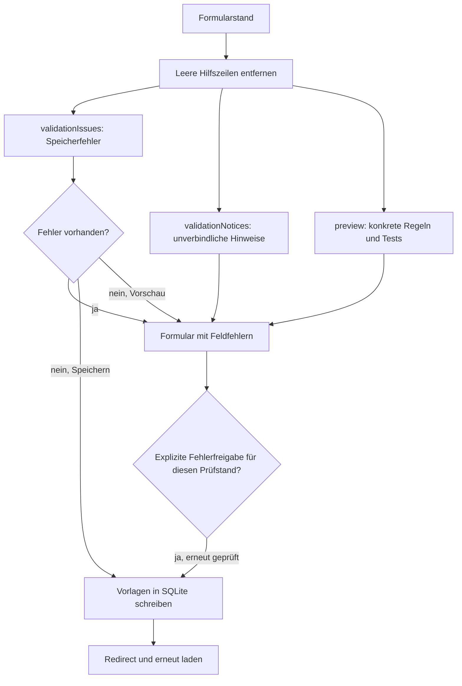

# Entwicklerleitfaden

Die Anwendung pflegt Vorlagen für Regeln und Beispiele des Timeparsers. Sie speichert diese in SQLite, erzeugt daraus konkrete Varianten und exportiert CSV-Dateien. Die echte Parser-Verarbeitung ist nicht eingebunden. Eine fehlerfreie Plausibilitätsprüfung belegt deshalb weder die tatsächliche Regelauswahl noch die korrekte Transformation oder Datumsinterpretation.

## Einstieg in den Code

| Aufgabe | Einstieg |
| --- | --- |
| Formularaufbau und Bearbeitungsaktionen | [RuleGroupForm](../src/main/java/de/deutsche_digitale_bibliothek/timeparser/web/RuleGroupForm.java), [RuleGroupFormEditor](../src/main/java/de/deutsche_digitale_bibliothek/timeparser/web/RuleGroupFormEditor.java), [RuleController](../src/main/java/de/deutsche_digitale_bibliothek/timeparser/web/RuleController.java) |
| Pflichtfelder und konkrete Testwerte prüfen | [RuleGroupValidator](../src/main/java/de/deutsche_digitale_bibliothek/timeparser/validation/RuleGroupValidator.java) |
| Masken, Variablen und Ausgabeverwendungen prüfen | [RulePatternValidator](../src/main/java/de/deutsche_digitale_bibliothek/timeparser/validation/RulePatternValidator.java) |
| Mögliche Maskenüberschneidungen erkennen | [RuleMaskOverlap](../src/main/java/de/deutsche_digitale_bibliothek/timeparser/validation/RuleMaskOverlap.java) |
| Persistenz, Expansion und Befunde koordinieren | [SqliteRuleRepository](../src/main/java/de/deutsche_digitale_bibliothek/timeparser/repository/SqliteRuleRepository.java) |
| Exportzeilen deduplizieren und Referenzen zuordnen | [ExportDatasetFactory](../src/main/java/de/deutsche_digitale_bibliothek/timeparser/export/ExportDatasetFactory.java) |
| Daten und Bericht eines Downloads zusammenhalten | [ExportSnapshot](../src/main/java/de/deutsche_digitale_bibliothek/timeparser/model/ExportSnapshot.java) |
| CSV und ZIP schreiben | [CsvExportService](../src/main/java/de/deutsche_digitale_bibliothek/timeparser/export/CsvExportService.java) |
| Hinweise anzeigen und Download ausliefern | [RuleOverviewController](../src/main/java/de/deutsche_digitale_bibliothek/timeparser/web/RuleOverviewController.java) |

Die `package-info.java`-Dateien beschreiben die Verantwortung der einzelnen Pakete. Die Javadocs an Klassen und Methoden erläutern deren Verträge und die nicht unmittelbar sichtbaren Entscheidungen.

Die gemeinsame Navigation liegt in `templates/fragments/navigation.html`. Ihr Parameter bestimmt den aktiven Bereich; Thymeleaf ergänzt weiterhin den konfigurierten Kontextpfad. `static/js/rule-tables.js` initialisiert die fünf Listentabellen anhand ihrer `data-rule-table`-Attribute. `data-table-language` wählt die bisherigen Sprachvarianten, `data-action-column` kennzeichnet eine nicht sortier- oder durchsuchbare Aktionsspalte. Die Detailansicht behält ihre eigene Formular- und Fehlerfreigabelogik.

## Vorlagen, Varianten und IDs

Eine Regelgruppe enthält gespeicherte Regelvorlagen; jede Vorlage hat eigene Testvorlagen. `RuleGroupForm` bildet diese Bearbeitungsstruktur ab. Die Felder dürfen Platzhalter wie `~approx` enthalten. Die Datenbank speichert diesen Text unverändert.

`Rule` und `RuleTest` werden sowohl beim CSV-Import als auch für konkrete erzeugte Zeilen verwendet. Diese Beans allein garantieren daher weder vollständige Expansion noch fachliche Gültigkeit. Die Formularklassen repräsentieren dagegen ausdrücklich den bearbeitbaren Vorlagenstand.

Das Repository unterscheidet intern:

- `RuleTemplate`: unexpandierte Werte und Herkunftsgruppe;
- `RuleTestTemplate`: unexpandierte Testwerte mit Bezug auf die Regelvorlage;
- `GeneratedRuleRow`: konkrete Regel, Vorlagen-ID und verwendete Platzhalterbelegung;
- `GeneratedTestCandidate`: passende Testkombination vor der Vergabe ihrer Ausgabe-ID.

Neue gespeicherte Vorlagen erhalten technische IDs wie `R42` und `T42`. Vorschauen für neue Zeilen arbeiten mit vorläufigen IDs. Erzeugte Varianten verwenden möglichst die Vorlagen-ID und anschließend Suffixe wie `R42_2`; Kollisionen werden innerhalb eines Generierungslaufs umgangen. Diese IDs können sich bei anderer Variantenreihenfolge ändern. Links zur Bearbeitung verwenden deshalb die gespeicherte Vorlagen-ID.

Vorläufige Regel-IDs reservieren zuerst alle expliziten IDs des Formulars, auch die unvollständiger Zeilen. Neue Zeilen erhalten danach eindeutige IDs. Vorschau, Testzuordnung, Validierung und Abdeckungshinweise verwenden dieselbe Zuordnung, ohne die Formularwerte zu ändern. So bleibt beispielsweise eine neue zweite Zeile von einer vorhandenen Vorlage `R2` getrennt.

`IdSequence` ermittelt den höchsten numerischen Suffix einmal pro Speichervorgang und zählt anschließend weiter. Dabei sind auch IDs des aktuellen Formulars reserviert: Beim Ersetzen einer Gruppe wurden deren Datenbankzeilen bereits gelöscht, ihre IDs dürfen dennoch nicht erneut vergeben werden. Der Zähler verwendet `BigInteger`, damit große importierte IDs nicht zu Überläufen führen.

## Ablauf beim Bearbeiten



Hinzufügen, Duplizieren und Entfernen im Formular verändern zunächst nur den übertragenen Formularstand. Die vollständige Gruppe wird erst beim Speichern geschrieben. Der Repository-Schreibzugriff führt die Formularprüfung nicht selbst aus; neue Aufrufer müssen diese Reihenfolge beachten. Auch der optionale initiale CSV-Import verwendet die Formularvalidierung nicht.

Bereits das Öffnen einer gespeicherten Gruppe führt die gemeinsame Fachvalidierung aus und stellt ein `BindingResult` für die bestehenden Feldmarkierungen bereit. Gespeicherte leere oder unvollständige Vorlagen bleiben dabei erhalten und sichtbar; die Bereinigung neuer Hilfszeilen gehört weiterhin zum Vorschau- und Speicherpfad.

Beim Aktualisieren einer Gruppe werden ihre Regel- und Testzeilen ersetzt. Vorhandene mitgegebene IDs bleiben erhalten; IDs neuer Zeilen werden vergeben, ohne sie in das übergebene Formular zurückzuschreiben. Der Redirect lädt anschließend den gespeicherten Stand.

## Fehler und Hinweise

Beide Arten verwenden `RulePatternValidator.Issue`. Die Bedeutung ergibt sich aus dem aufgerufenen Prüfweg, nicht aus einem Schweregradfeld im Record.

| Prüfweg | Bedeutung | Behandlung |
| --- | --- | --- |
| `validationIssues(form)` | Pflichtfelder, Struktur, Masken-/Musterfehler, nicht auflösbare Platzhalter, Dubletten und konkrete Feldfehler | `RuleGroupFormValidator` bindet sie an Spring-Feldfehler; reguläres Speichern wird verhindert. Eine gesonderte ausdrückliche Fehlerfreigabe erlaubt das Speichern des geprüften Stands. |
| `validationNotices(form)` | fehlende Tests je erzeugter Variante und mögliche Überschneidungen gleich spezifischer Masken | Anzeige zusätzlich zur Vorschau; Speichern bleibt möglich. |
| `plausibilityWarnings()` | zusammengeführte Befunde zu gespeicherten Gruppen, einschließlich Dublettenfundstellen | Verlinkbare Darstellung; kein Exportverbot. |

Ein `Issue.field` ist entweder ein relativer Feldname wie `outputPattern` oder nach der Repository-Zuordnung ein vollständiger Formularpfad wie `rules[0].tests[1].output`. Der Code, etwa `variable.undefined`, eignet sich zur gezielten Zuordnung in Tests. Der deutsche Meldungstext dient der Oberfläche. `PlausibilityWarning.type` bezeichnet den Anzeigebereich, beispielsweise „Regel“ oder „Test“, und ist ebenfalls kein Schweregrad.

Bei Literalabweichungen ergänzt `CharacterDiagnostic` das erwartete und vorhandene Zeichen mit Unicode-Codepoint. Die Positionsangabe bleibt ein UTF-16-Index plus eins; liegt die erste Abweichung in einem Low-Surrogat, beschreibt die Meldung dennoch das vollständige Zeichen. Die Liveprüfung im Detailformular verwendet dieselbe Darstellung für konkrete tokenisierte Eingaben und Masken-/Musterliterale. Testausgaben werden im Browser weiterhin nur auf Länge geprüft, da ihre vollständige Prüfmaske von den serverseitig aufgelösten Variablen abhängt.

Die Liveprüfung füllt Ziffernvorlagen im Feld „Tokenisiert“ zunächst aus der rohen Testeingabe, etwa `####` aus `1900`. Wie im Repository müssen dabei Länge und sämtliche Literale passen; eine teilweise Ersetzung findet nicht statt. Enthält die rohe Eingabe noch Platzhalter, wird diese Prüfung der serverseitigen Expansion überlassen. Die eingegebenen Formularwerte bleiben erhalten.

Speicherfehler werden einmal je Feldpfad und Prüfcode ausgegeben; der zuerst erfasste Meldungstext bleibt erhalten. Unterschiedliche Prüfcodes am selben Feld und derselbe Code an verschiedenen Feldern bleiben getrennt. Variantenbezogene Hinweise werden nicht nach diesem Schlüssel zusammengeführt, da ihre Meldungen unterschiedliche Varianten beschreiben können.

Der Fehlerindex verwendet dafür einen `IssueKey` aus Feld und Code. Regel- und Testgleichheit vergleichen dagegen unveränderliche Listen ihrer Feldwerte; Testschlüssel enthalten zusätzlich die Regelwerte. Dadurch bleiben Feldgrenzen selbst dann eindeutig, wenn eingegebene Werte Steuerzeichen enthalten. Ein Zeichen als Feldtrenner wäre hierfür nicht ausreichend.

Die Prüfung einer bearbeiteten Gruppe vergleicht sie mit anderen Gruppen und dem neuen Formularstand. Ihre bisherige gespeicherte Fassung wird ausgenommen, damit unveränderte Daten nicht als Dubletten ihrer eigenen Fassung gelten.

Eine Fehlerfreigabe wird nur angeboten, nachdem die aktuellen Fachfehler angezeigt wurden. Dafür enthält die Detailansicht einen serverseitig signierten Prüfstand und eine gesonderte Submit-Aktion `saveInvalid=true`; der normale Speicherknopf übermittelt keine Zustimmung. `validationReview` bindet die Freigabe an Formularinhalt, IDs und Reihenfolge sowie die angezeigten Fehler. Jeder Speicheraufruf validiert erneut. Ein fehlender oder nicht mehr passender Prüfstand führt zur erneuten Fehleranzeige, ohne Daten zu schreiben. Tatsächliche Binding-/Typfehler bleiben auch mit Zustimmung blockierend.

Eine Zustimmung wird weder gespeichert noch bei erneut angezeigten Formularen vorbelegt. Die Oberfläche deaktiviert die Fehlerfreigabe schon bei Eingaben; der Server überprüft unabhängig davon den Prüfstand. Nach Änderungen oder neuen Fehlern ist eine erneute ausdrückliche Zustimmung erforderlich. Bestätigt gespeicherte Fachfehler bleiben beim erneuten Öffnen und im Plausibilitätscheck erkennbar.

Der Gesamtcheck lädt Gruppenmetadaten, Regel- und Testvorlagen sowie Platzhalter in einer festen Anzahl von Datenbankabfragen. Ein aufrufgebundener `ValidationContext` expandiert den Vergleichsbestand einmal und hält Suchindizes für Eingabemasken, Gruppen und Testsignaturen bereit. Die Formularstruktur wird aus den bereits gelesenen Vorlagen aufgebaut. Mögliche Maskenüberschneidungen werden nur innerhalb kompatibler Zeichenstrukturen und gleicher Anzahl von `#`-Stellen verglichen; Literale einschließlich der verschiedenen Leerzeichen bleiben dabei exakt erhalten. `RuleMaskOverlap.witness` entscheidet weiterhin über den tatsächlichen statischen Hinweis. Es gibt keinen Cache zwischen Aufrufen, sodass Regel- und Platzhalteränderungen unmittelbar berücksichtigt werden. Der Export verwendet dieselbe Aufbereitung.

Der Kontext indiziert außerdem die Varianten je Regelvorlage. Der Export prüft einen nicht zugeordneten Test nur gegen diese Varianten statt wiederholt gegen den gesamten Bestand. Die abgeleitete Ausgabeprüfmaske wird je konkreter Regel einmal berechnet und für deren Testfälle wiederverwendet. Diese Optimierungen verändern weder die Reihenfolge noch den Inhalt der Befunde.

Bei generierten Regeldubletten und Transformationskonflikten nennt der Feldfehler die vorhandene Regel-ID, Regelgruppe und Vorlage. `Issue.relatedRules` bewahrt diese Fundstellen strukturiert; die Plausibilitätsansicht verlinkt sowohl die geprüfte Regel als auch die Fundstelle. Der Link verwendet die Vorlagen-ID, auch wenn die angezeigte generierte ID ein Variantensuffix enthält.

## Masken- und Testverträge

Masken und Muster werden mit Java-`char`-Indizes und damit UTF-16-Längen verglichen. Die Maske bestimmt die Zeichenkategorie; gleiche Musterbuchstaben an den entsprechenden Zeichenpositionen benennen einen Wert. Wenn die Eingabemaske dort zusammenhängende `#`-Zeichen enthält, entsteht eine Ziffernvariable. Die Maskenpaare `MM` und `GG` kennzeichnen Monats- und Wochentagsersetzungen und benötigen jeweils zwei gleiche Musterbuchstaben; sonstige Maskenzeichen sind Literale. Der erste Musterbuchstabe ist intern der Name, die Anzahl seiner Wiederholungen ist die Breite. `NN` bezeichnet damit einen Wert namens N mit zwei Zeichen, nicht zwei getrennte N-Werte. Diese Namen besitzen keine reservierte Datumsbedeutung.

Bei Eingabemaske `##.####`, Eingabemuster `NN.JJJJ` und Eingabe `03.2010` erfasst `NN` den Wert `03`, während `JJJJ` den Wert `2010` erfasst. Mit Ausgabemaske `####-##` und Ausgabemuster `JJJJ-NN` werden diese Werte zu `2010-03` zusammengesetzt. Wird das Eingabemuster in `MM.JJJJ` geändert, erhält die erste Ziffernvariable den Namen M mit Breite zwei; `MM` erfasst weiterhin `03`. Das passende Ausgabemuster lautet dann `JJJJ-MM`.

Für Monatsnamen lautet die **Eingabemaske** dagegen beispielsweise `MM ####`; das **Eingabemuster** kann `NN JJJJ` lauten. `März 2010` wird für die Regelauswahl zu `MM 2010` tokenisiert. Bei der anschließenden Transformation liefert die Monatsersetzung den Wert `03`, den das Eingabemuster als N mit Breite zwei erfasst. Das **Ausgabemuster** `JJJJ-NN` setzt diesen Wert mit dem Jahr zu `2010-03` zusammen. Diese Umwandlung führt ausschließlich der Timeparser aus, nicht dieser Editor.

Die **Ausgabemaske** `####-MM` wird mit **Ausgabemuster** `JJJJ-NN` ebenfalls als Ausgabe mit zwei Variablenstellen nach dem Bindestrich verarbeitet. Stammt N wie im Beispiel aus `03`, entsteht konkret `2010-03`: Die Maskenzeichen `MM` werden durch den von `NN` bezeichneten Wert ersetzt. Sie werden weder als Buchstaben `MM` ausgegeben noch in einen Monatsnamen umgewandelt. Der `Outputter` übernimmt den Wert anhand des Namens aus dem Ausgabemuster; die Ausgabekategorie entscheidet nicht über diesen Wert. Für die numerische Ausgabe ist die Ausgabemaske `####-##` deutlicher lesbar.

Die Regelauswahl unterscheidet ausschließlich Eingabemasken. Bei **Eingabemaske** `##.####` und **Eingabemuster** `NN.JJJJ` erfassen die ersten beiden Stellen den Wert `03`; **Ausgabemaske** `####` und **Ausgabemuster** `JJJJ` lassen diesen Wert weg und liefern `2010`. Mit **Eingabemuster** `MM.JJJJ`, **Ausgabemaske** `####-##` und **Ausgabemuster** `JJJJ-MM` wird `03` übernommen und `2010-03` ausgegeben. Beide Regeln bleiben wegen derselben Eingabemaske ein Transformationskonflikt. Ein anderer Variablenname schafft keine neue Eingabeform.

Im Eingabemuster darf ein Name nur einmal definiert werden. Die Ausgabe darf eine Eingabevariable mehrfach und gekürzt verwenden. Jede Verwendung muss in die Eingabebreite passen; die längste Verwendung bestimmt somit die notwendige Breite. Führende Nullen müssen als Literale modelliert werden. Beispielsweise ergibt `###` / `JJJ` nach `0###` / `0JJJ` eine vierstellige Ausgabeform.

`outputTestMask` leitet die prüfbare Zeichenform der Ausgabe aus den Eingabevariablen ab. Monatswerte werden zu Ziffern, Wochentagswerte bleiben als `GG` tokenisiert. Die Methode erzeugt keine tatsächliche Ausgabe und ersetzt keine Kalendernamen.

`RuleGroupValidator.validateTest` prüft die konkrete tokenisierte Eingabe und Ausgabe gegen diese Zeichenformen. Der Feldvalidator akzeptiert an `#`-Stellen ASCII-Ziffern. Die einfache Zuordnung generierter Tests im Repository verwendet dagegen `Character.isDigit`; deshalb bedeutet „generiert“ noch nicht „ohne Feldfehler“.

Ein leerer erwarteter Zeitraum bleibt zulässig. Ein gesetzter Zeitraum muss zwei mit `LocalDate.parse` lesbare Daten im Format `Start/Ende` enthalten und darf nicht rückwärts laufen. Die ISO-/Java-Grenzen gelten auch für historische oder große Jahreszahlen. Es wird nicht geprüft, ob dieser Zeitraum aus der ursprünglichen Eingabe oder der erwarteten Ausgabe folgt.

## Platzhalterexpansion

Referenzen haben die Form `~name`. Namen werden über `tokenLookupKey` ohne Beachtung der Großschreibung verglichen; der historische Alias `aprox` wird auf `approx` abgebildet. Dieselbe normalisierte Referenz erhält innerhalb einer Belegung in allen Regel- und Testfeldern denselben Wert.

Mehrere unterschiedliche Namen erzeugen ein kartesisches Produkt ihrer Werte. Ein Test übernimmt zunächst die Belegung seiner konkreten Regelvariante. Nur Namen, die zusätzlich im Test vorkommen, erzeugen weitere Kombinationen. Die Ersetzung erfolgt in einem Durchlauf; eingefügte Werte werden nicht rekursiv als weitere Referenzen expandiert.

Die Erzeugung eines Tests prüft anschließend, ob sein tokenisierter Wert zur konkreten Eingabemaske passt. Eine Vorlage für `ca. 1950` kann damit bewusst nur die `ca.`-Variante einer umfangreicheren `~approx`-Regel abdecken. Andere Varianten werden als ungetestet angezeigt. Nicht passende Kombinationen werden bei der Generierung ausgelassen.

`#`-Stellen einer tokenisierten Testvorlage können aus einer gleich langen konkreten Eingabe übernommen werden. Das funktioniert nur, wenn an diesen Stellen Ziffern stehen und sämtliche übrigen Zeichen übereinstimmen. Monats- oder Wochentagsnamen werden dabei nicht tokenisiert.

Platzhalterwerte werden nicht getrimmt. Leerzeichen können durch ihre Position im erzeugten Text fachlich relevant sein. Führende oder abschließende Leerzeichen in exportierten Feldern werden dagegen beanstandet, weil der CSV-Leser des Timeparsers sie entfernt.

## Exportaufbereitung und Prüfbericht

`exportSnapshot()` liest Vorlagen und Platzhalter, erzeugt konkrete Zeilen und sammelt dazu die aktuellen Befunde. Beim Aufruf über den Spring-Bean gilt die markierte Lesetransaktion. Die anschließenden Methoden `rulesCsv(snapshot)`, `testsCsv(snapshot)` und `rulesAndTestsZip(snapshot)` serialisieren ausschließlich diesen Stand.

`ExportDatasetFactory` verwendet vier Regelwerte als Gleichheitskriterium: Eingabemaske, Eingabemuster, Ausgabemaske und Ausgabemuster. IDs und Gruppen gehören nicht zur Signatur. Bei exakten Dubletten bleibt die zuerst übergebene Regel erhalten. Das Repository übergibt die Regeln natürlich nach ID sortiert.

Tests entfernter Dubletten werden auf die verbleibende Regel-ID umgehängt. Testgleichheit enthält diese kanonische Regel-ID und alle vier Testwerte. Gleiche Beispiele verschiedener Transformationen bleiben erhalten. Verschiedene Transformationen mit derselben Eingabemaske werden ebenfalls nicht entfernt; der Bericht weist darauf hin, dass der Timeparser nur die erste Regel je Maske lädt.

Nicht auflösbare Vorlagen und nicht zuordenbare Tests können nicht als konkrete Zeilen ausgegeben werden. Sie werden mit einem ausdrücklichen Hinweis ausgelassen. Andere expandierbare Zeilen bleiben auch bei Plausibilitätsfehlern exportierbar.

Der Export-Controller zeigt bei Befunden zunächst eine Hinweisseite. `?download=true` erlaubt weiterhin den Download und erzeugt dafür einen aktuellen Snapshot. Die Header `X-Timeparser-Plausibility-Warnings` und `X-Timeparser-Validation: plausibility-only` benennen Anzahl und Art der Prüfung. Im ZIP stehen `rules.csv`, `tests.csv` und `pruefhinweise.txt`. CSV-Einzeldownloads enthalten keine zusätzlichen Kommentarzeilen, damit ihre Spaltenstruktur erhalten bleibt.

Zwei getrennte Downloads können unterschiedliche Datenbankstände verwenden. Für Regeln und Tests aus einem gemeinsamen Stand dient das ZIP. Die Listen in `ExportDataset` und `ExportSnapshot` sind strukturell unveränderlich; die enthaltenen `Rule`-/`RuleTest`-Beans sind weiterhin veränderlich und sollten nach der Snapshot-Erzeugung nicht bearbeitet werden.

## Platzhalter ändern oder löschen

`groupsUsingToken` untersucht Referenzen in den Vorlagen, nicht nur bereits erzeugte Zeilen. Es muss vor dem Umbenennen oder Löschen aufgerufen werden, solange die alte Definition noch bekannt ist. Der Token-Controller zeigt die betroffenen Gruppen anschließend als Flashhinweis an.

Umbenennen oder Löschen schreibt Referenzen nicht automatisch um. Betroffene Gruppen bleiben gespeichert und können danach nicht auflösbare Namen enthalten. Der nächste Plausibilitätscheck und Export bewertet den aktuellen Zustand neu. Der separate Token-CSV-Export ist ein Editorformat und ersetzt nicht die `calendar_tokens.csv` des Timeparsers.

## Änderungen und Verifikation

Neue feldbezogene Regeln gehören möglichst in die zuständige Validierungsklasse. Prüfungen mit Datenbank-, Platzhalter- oder Gruppenbezug werden im Repository koordiniert. Unverbindliche Befunde dürfen nicht über `validateForSave` als Feldfehler gebunden werden. Eine neue Exportvariante sollte denselben `ExportDataset` und `ExportSnapshot` verwenden, statt eine eigene Deduplizierung aufzubauen.

Die Tests folgen diesen Zuständigkeiten: reine Maskenprüfungen unter `validation`, Expansion und Snapshot-Zuordnung unter `repository`, CSV-Serialisierung unter `export` und Formular-/Downloadabläufe unter `web`. `TimeparserRulesApplicationTest` prüft zusätzlich Spring-Konfiguration, HTML-Darstellung und WebJar-Ressourcen.

```bash
mvn test
```

Die spätere Ausführung der Regeltests soll über eine gemeinsame Timeparser-Library erfolgen. Bis dahin prüfen die Tests die Editorlogik und Exportverträge; eine vollständige Verarbeitung des aktuellen Regelbestands im Timeparser findet hier nicht statt. Details stehen im [README](../README.md#kompatibilität-mit-dem-timeparser).
